<h1 align="center">Kafkaesque</h1>

<p align="center">
  <strong>Kafka cluster inspection and observability from a CLI and web dashboard.</strong><br>
  Inspect brokers, topics, partitions, consumer groups, cluster health, and consumer lag without changing Kafka.
</p>

<p align="center">
  <a href="https://github.com/nikhil25803/kafkaesque/releases/latest"></a>
  <a href="https://github.com/nikhil25803/kafkaesque/releases"></a>
  <a href="go.mod"></a>
  <a href="https://github.com/nikhil25803/kafkaesque/actions/workflows/ci.yml"></a>
  <a href="https://github.com/nikhil25803/kafkaesque/actions/workflows/tests.yml"></a>
  <a href="https://github.com/nikhil25803/kafkaesque/actions/workflows/kafka-integration.yml"></a>
  <a href="LICENSE"></a>
</p>

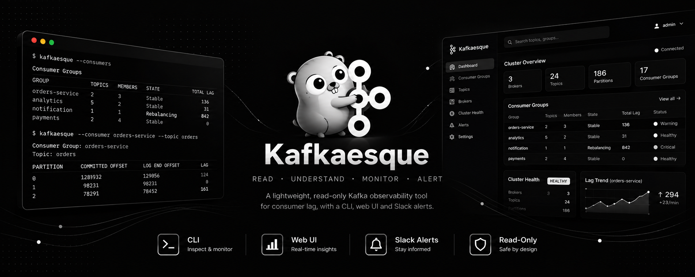

## Why Kafkaesque?

Kafkaesque gives developers and operators a focused view of Kafka without the
weight of a full metrics platform. Use it to answer practical questions:

- Can this client connect and authenticate to the cluster?
- Which brokers, topics, partitions, and consumer groups exist?
- Which partitions are offline or under-replicated?
- Which consumer groups are rebalancing, dead, or lagging?
- What are the committed offset, log-end offset, and lag for each partition?

Kafka inspection is read-only. The server writes only authentication, session,
user, and role data to PostgreSQL.

## Features

- Text and JSON CLI output, including in-place watch mode.
- Plaintext, TLS, mTLS, SASL PLAIN, SCRAM-SHA-256, and SCRAM-SHA-512 Kafka connections.
- Cluster health, broker, topic, partition, consumer-group, member, and lag inspection.
- Responsive web dashboard with live request-time Kafka data.
- Authenticated HTTP API with opaque access and refresh tokens.
- PostgreSQL-backed users, roles, and account-management permissions.
- Multi-architecture container images for Linux AMD64 and ARM64.

See [Features and limitations](docs/features.md) for the complete capability
map and intentionally unsupported functionality.

## Quick start

### 1. Inspect Kafka from the CLI

Install the latest release on Linux or macOS:

```sh
curl -fsSL https://raw.githubusercontent.com/nikhil25803/kafkaesque/main/install.sh | sh
export PATH="$HOME/.local/bin:$PATH"
```

Point Kafkaesque at a broker and run the connection check:

```sh
export KAFKAESQUE_KAFKA_BOOTSTRAP_SERVER=localhost:9092
kafkaesque --check
kafkaesque --health
kafkaesque --consumers
```

CLI inspection does not require PostgreSQL or application accounts. See
[Getting started](docs/getting-started.md) for YAML, authenticated Kafka, and
consumer-lag examples.

### 2. Run the container

```sh
docker pull ghcr.io/nikhil25803/kafkaesque:<release-tag>
```

The container starts `kafkaesque serve`, so it requires PostgreSQL and the
Super Admin bootstrap values in addition to Kafka configuration. Follow the
[container and Kubernetes deployment guide](docs/deployment.md) for a runnable
setup. Choose an exact tag from
[GitHub Releases](https://github.com/nikhil25803/kafkaesque/releases) or pin an
image digest.

### 3. Open the web UI

After starting the server, visit `/ui`, sign in with the configured account,
and inspect the live cluster. The same process serves the authenticated API at
`/api/v1` and the public process check at `/api/v1/health`.

## CLI reference

### General and presentation

| Flag                  | Description (including required or related flags)                                       | Example                              |
| --------------------- | --------------------------------------------------------------------------------------- | ------------------------------------ |
| `-h`, `--help`        | Show command help.                                                                      | `kafkaesque --help`                  |
| `-v`, `--version`     | Show the installed Kafkaesque version.                                                  | `kafkaesque --version`               |
| `--output text\|json` | Select text or structured JSON output. Requires an information flag; default is `text`. | `kafkaesque --brokers --output json` |
| `--watch <seconds>`   | Refresh an information command in place at a positive interval.                         | `kafkaesque --health --watch 10`     |

### Checks and configuration

| Flag                     | Description (including required or related flags)                                                                        | Example                                            |
| ------------------------ | ------------------------------------------------------------------------------------------------------------------------ | -------------------------------------------------- |
| `--config <path>`        | Load an explicit YAML file. It also works with `serve`.                                                                  | `kafkaesque --config ./kafkaesque.yaml --metadata` |
| `--check [config\|conn]` | Validate configuration or Kafka connectivity. Bare `--check` means `conn` and cannot be combined with information flags. | `kafkaesque --check`                               |

### Information

| Flag                 | Description (including required or related flags)                                                          | Example                                                        |
| -------------------- | ---------------------------------------------------------------------------------------------------------- | -------------------------------------------------------------- |
| `-m`, `--metadata`   | Show cluster identity and totals.                                                                          | `kafkaesque --metadata`                                        |
| `--health`           | Show cluster, partition, and consumer health. Standalone except for `--config`, `--output`, and `--watch`. | `kafkaesque --health`                                          |
| `-b`, `--brokers`    | List brokers, advertised addresses, effective connection addresses, and racks.                             | `kafkaesque --brokers`                                         |
| `-t`, `--topics`     | List internal and external topics with partition and replication information.                              | `kafkaesque --topics`                                          |
| `-p`, `--partitions` | List partition leaders, replicas, ISR, and health. Requires `--topic`.                                     | `kafkaesque --partitions --topic orders`                       |
| `--topic <name>`     | Select a topic for `--partitions` or detailed `--consumer` inspection.                                     | `kafkaesque --consumer --group order-processor --topic orders` |
| `-c`, `--consumers`  | List consumer groups. Cannot be combined with `--consumer`.                                                | `kafkaesque --consumers`                                       |
| `--consumer`         | Inspect one consumer group. Requires `--group`.                                                            | `kafkaesque --consumer --group order-processor`                |
| `--member`           | Include member assignments. Requires `--consumer` and `--group`; cannot be combined with `--topic`.        | `kafkaesque --consumer --member --group order-processor`       |
| `--group <name>`     | Select the group inspected by `--consumer`.                                                                | `kafkaesque --consumer --group order-processor`                |

Information flags can share one request when their selectors are compatible:

```sh
kafkaesque --metadata --brokers --topics
```

### Server-only flags

Use these with `kafkaesque serve`. Authentication and PostgreSQL are required.

| Flag            | Description (including required or related flags)   | Example                           |
| --------------- | --------------------------------------------------- | --------------------------------- |
| `--host <host>` | Override `api.host` for this server process.        | `kafkaesque serve --host 0.0.0.0` |
| `--port <port>` | Override `api.port`; accepted range is `1`–`65535`. | `kafkaesque serve --port 8085`    |

See the [complete CLI reference](docs/cli-reference.md) for output examples,
watch behavior, and exit codes.

## Configuration

Kafkaesque applies configuration in this order, with later values winning:

```text
defaults → YAML → environment variables → explicit serve flags
```

CLI inspection needs only Kafka and optional lag configuration. `serve` also
requires PostgreSQL and the Super Admin bootstrap values.

<details>
<summary><strong>Complete YAML example</strong></summary>

```yaml
kafka:
  # Use bootstrap_server for one broker, or bootstrap_servers for several.
  # Do not configure both forms.
  bootstrap_servers:
    - kafka-1.example.com:9093
    - kafka-2.example.com:9093
  connection_timeout: 10s

  # Map addresses advertised by Kafka to addresses reachable by Kafkaesque.
  broker_address_overrides:
    "broker-1.kafka.svc.cluster.local:9092": "kafka-1.example.com:9093"

  security:
    tls:
      enabled: true
      # Omit ca_file to use system roots.
      ca_file: /etc/kafka/tls/ca.pem
      # Providing both client files enables mTLS.
      client_cert_file: /etc/kafka/tls/client.pem
      client_key_file: /etc/kafka/tls/client-key.pem
      server_name: kafka.example.com

    # A non-empty mechanism enables SASL. Supported values are PLAIN,
    # SCRAM-SHA-256, and SCRAM-SHA-512. Always combine PLAIN with TLS.
    sasl:
      mechanism: SCRAM-SHA-256
      username: <kafka-username>
      password: <kafka-password>

lag:
  warning_threshold: 100
  unhealthy_threshold: 500

authentication:
  super_admin_username: super_admin
  super_admin_email: super-admin@example.com
  # Use 8-99 characters with uppercase, lowercase, a number, and one of
  # !@#$%^&*()_.
  super_admin_password: <policy-compliant-password>
  # verify is the safe default. reinitialize can delete the public schema.
  super_admin_recovery: verify
  access_ttl: 15m
  refresh_ttl: 168h
  cookie_secure: true

database:
  url: postgres://kafkaesque:<url-encoded-password>@postgres:5432/kafkaesque?sslmode=require

api:
  host: 0.0.0.0
  port: 8085
```

Remove TLS, mTLS, or SASL values that your Kafka listener does not use. YAML
certificate paths are resolved relative to the configuration file; absolute
paths are recommended in containers.

</details>

<details>
<summary><strong>Complete environment-variable reference</strong></summary>

Environment values always override their YAML equivalent.

| Environment variable                             | YAML equivalent                       | Format or purpose                                                                                                |
| ------------------------------------------------ | ------------------------------------- | ---------------------------------------------------------------------------------------------------------------- |
| `KAFKAESQUE_KAFKA_BOOTSTRAP_SERVER`              | `kafka.bootstrap_server`              | One `host:port`; do not combine with the plural variable. Defaults to `localhost:9092` when neither form is set. |
| `KAFKAESQUE_KAFKA_BOOTSTRAP_SERVERS`             | `kafka.bootstrap_servers`             | Comma-separated `host:port` values; replaces the configured list.                                                |
| `KAFKAESQUE_KAFKA_CONNECTION_TIMEOUT`            | `kafka.connection_timeout`            | Positive Go duration; default `10s`.                                                                             |
| `KAFKAESQUE_KAFKA_BROKER_ADDRESS_OVERRIDES`      | `kafka.broker_address_overrides`      | JSON object such as `{"broker:9092":"reachable:9094"}`.                                                          |
| `KAFKAESQUE_KAFKA_SECURITY_TLS_ENABLED`          | `kafka.security.tls.enabled`          | Boolean enabling TLS; default `false`.                                                                           |
| `KAFKAESQUE_KAFKA_SECURITY_TLS_CA_FILE`          | `kafka.security.tls.ca_file`          | Absolute mounted CA path; omit to use system roots.                                                              |
| `KAFKAESQUE_KAFKA_SECURITY_TLS_CLIENT_CERT_FILE` | `kafka.security.tls.client_cert_file` | Client certificate path; requires the client key.                                                                |
| `KAFKAESQUE_KAFKA_SECURITY_TLS_CLIENT_KEY_FILE`  | `kafka.security.tls.client_key_file`  | Client key path; requires the client certificate.                                                                |
| `KAFKAESQUE_KAFKA_SECURITY_TLS_SERVER_NAME`      | `kafka.security.tls.server_name`      | Optional certificate hostname override.                                                                          |
| `KAFKAESQUE_KAFKA_SECURITY_SASL_MECHANISM`       | `kafka.security.sasl.mechanism`       | `PLAIN`, `SCRAM-SHA-256`, or `SCRAM-SHA-512`.                                                                    |
| `KAFKAESQUE_KAFKA_SECURITY_SASL_USERNAME`        | `kafka.security.sasl.username`        | SASL username; required with a mechanism.                                                                        |
| `KAFKAESQUE_KAFKA_SECURITY_SASL_PASSWORD`        | `kafka.security.sasl.password`        | SASL password; required with a mechanism.                                                                        |
| `KAFKAESQUE_LAG_WARNING_THRESHOLD`               | `lag.warning_threshold`               | Non-negative integer; default `100`.                                                                             |
| `KAFKAESQUE_LAG_UNHEALTHY_THRESHOLD`             | `lag.unhealthy_threshold`             | Integer greater than the warning threshold; default `500`.                                                       |
| `KAFKAESQUE_AUTHENTICATION_SUPER_ADMIN_USERNAME` | `authentication.super_admin_username` | Required by `serve`; 3–64 character handle or configured email.                                                  |
| `KAFKAESQUE_AUTHENTICATION_SUPER_ADMIN_EMAIL`    | `authentication.super_admin_email`    | Required normalized Super Admin email.                                                                           |
| `KAFKAESQUE_AUTHENTICATION_SUPER_ADMIN_PASSWORD` | `authentication.super_admin_password` | Required 8–99 characters with uppercase, lowercase, a number, and one of `!@#$%^&*()_`.                          |
| `KAFKAESQUE_AUTHENTICATION_SUPER_ADMIN_RECOVERY` | `authentication.super_admin_recovery` | `verify` (default), `update`, or destructive `reinitialize`.                                                     |
| `KAFKAESQUE_AUTHENTICATION_ACCESS_TTL`           | `authentication.access_ttl`           | Positive duration; default `15m`.                                                                                |
| `KAFKAESQUE_AUTHENTICATION_REFRESH_TTL`          | `authentication.refresh_ttl`          | Duration greater than access TTL; default `168h`.                                                                |
| `KAFKAESQUE_AUTHENTICATION_COOKIE_SECURE`        | `authentication.cookie_secure`        | Boolean; default `true`, disable only for trusted local HTTP.                                                    |
| `KAFKAESQUE_DATABASE_URL`                        | `database.url`                        | Complete PostgreSQL 18+ URL; required by `serve`.                                                                |
| `KAFKAESQUE_API_HOST`                            | `api.host`                            | Listener host; default `0.0.0.0`.                                                                                |
| `KAFKAESQUE_API_PORT`                            | `api.port`                            | Integer from `1` through `65535`; default `8085`.                                                                |

Container deployments should inject passwords through Secrets and mount TLS
files read-only rather than placing sensitive values in the image or command.

</details>

For advanced validation and production use, read
[Configuration](docs/configuration.md), [Deployment](docs/deployment.md),
[TLS and SASL](docs/guides/tls-sasl.md), and
[Runtime security](docs/security.md).

## UI sneak peek

<table>
  <tr>
    <td colspan="2" align="center">
      <strong>Dashboard</strong><br>
      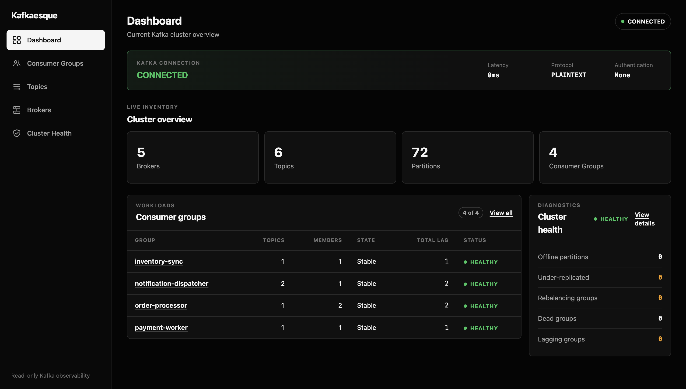
    </td>
  </tr>
  <tr>
    <td align="center" width="50%">
      <strong>Consumer Groups</strong><br>
      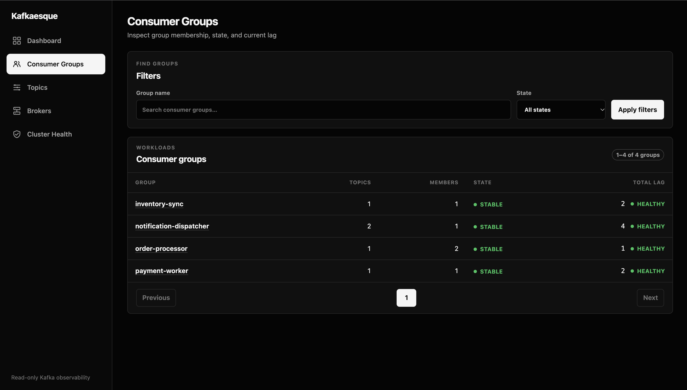
    </td>
    <td align="center" width="50%">
      <strong>Consumer Group Summary</strong><br>
      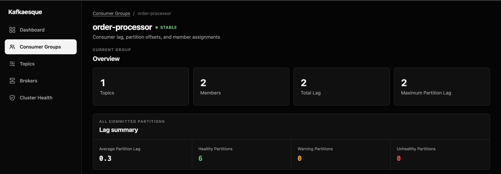
    </td>
  </tr>
  <tr>
    <td align="center" width="50%">
      <strong>Partition Lag and Topic Summary</strong><br>
      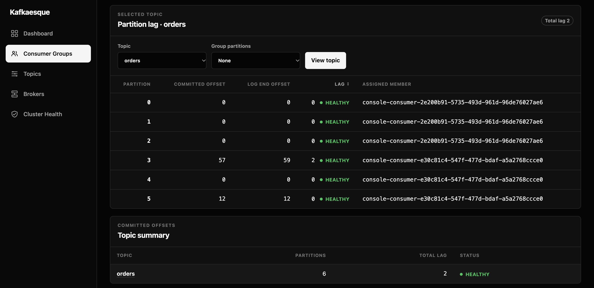
    </td>
    <td align="center" width="50%">
      <strong>Topics</strong><br>
      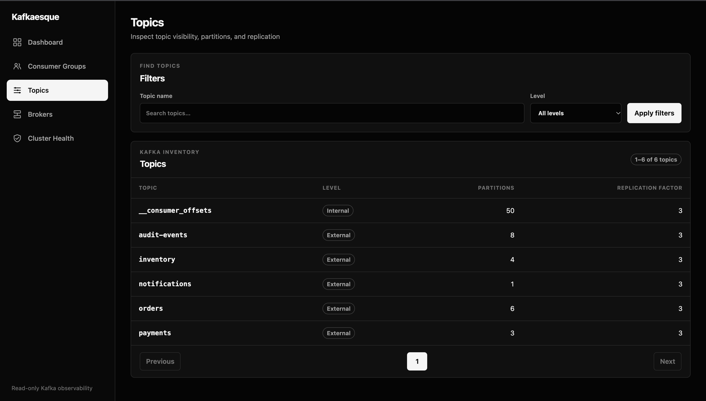
    </td>
  </tr>
  <tr>
    <td align="center" width="50%">
      <strong>Brokers</strong><br>
      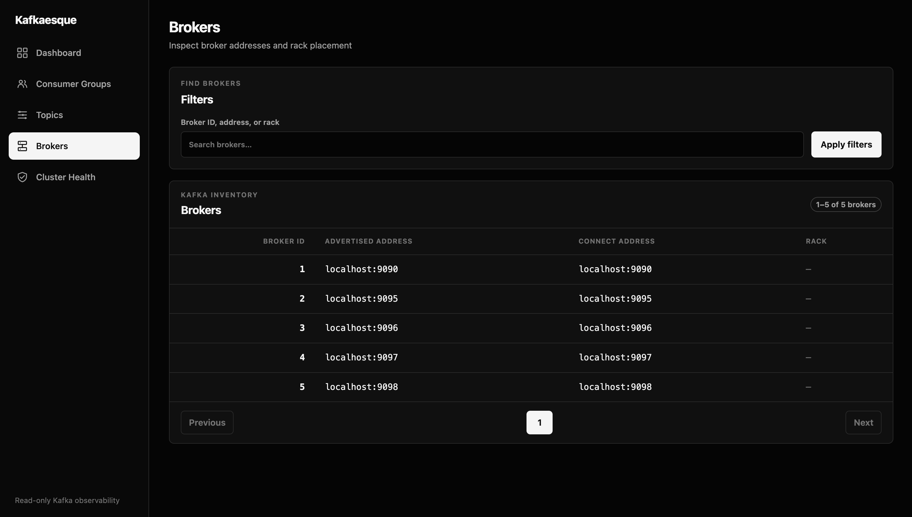
    </td>
    <td align="center" width="50%">
      <strong>Cluster Health</strong><br>
      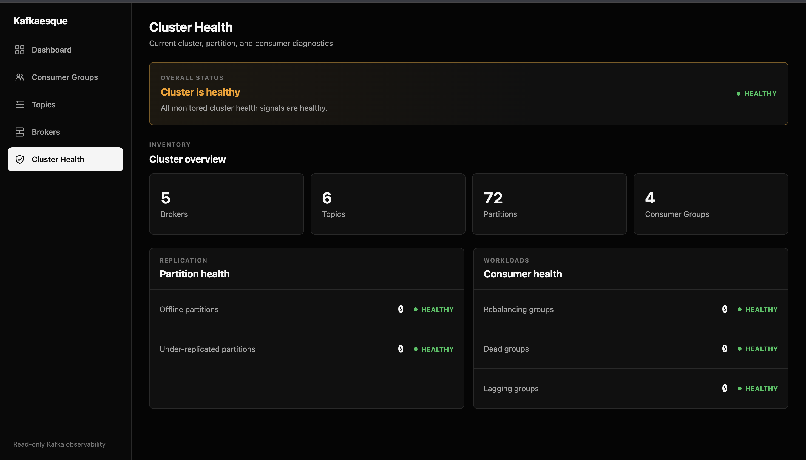
    </td>
  </tr>
  <tr>
    <td colspan="2" align="center">
      <strong>Login</strong><br>
      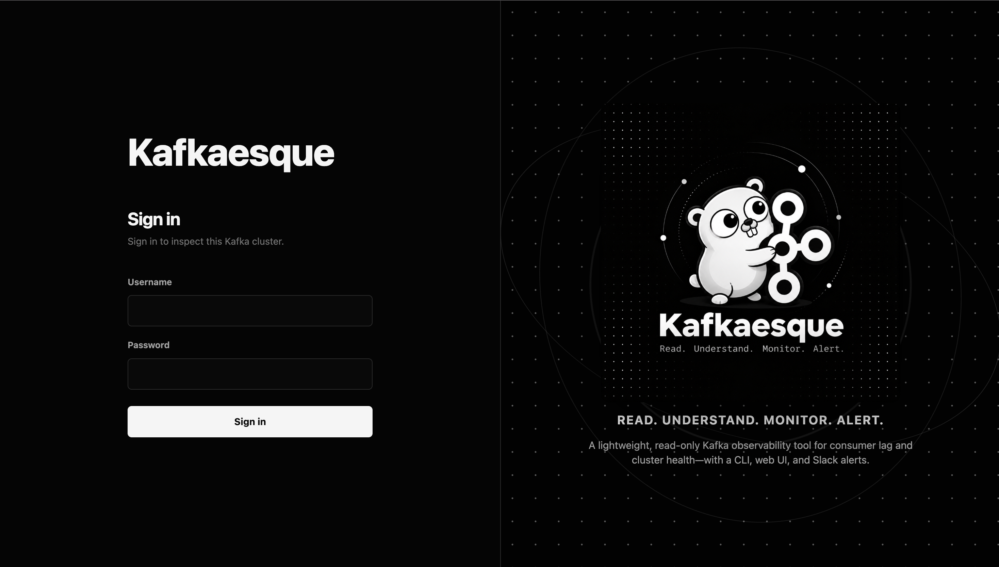
    </td>
  </tr>
  <tr>
    <td align="center" width="50%">
      <strong>Users</strong><br>
      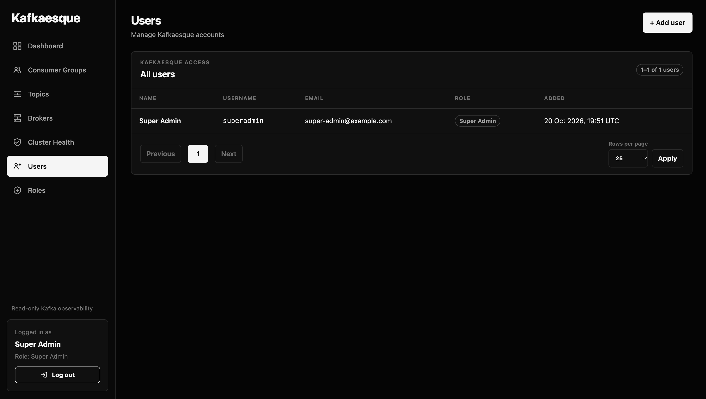
    </td>
    <td align="center" width="50%">
      <strong>Roles</strong><br>
      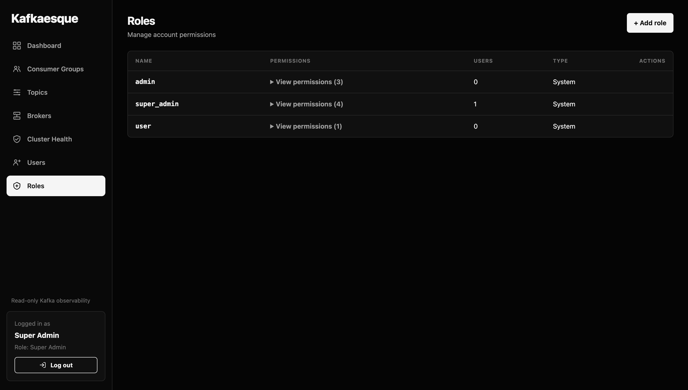
    </td>
  </tr>
</table>

## Common workflows

| Goal                                    | Start here                                            |
| --------------------------------------- | ----------------------------------------------------- |
| Find a lagging consumer group           | [Consumer lag guide](docs/guides/consumer-lag.md)     |
| Understand degraded cluster health      | [Cluster health guide](docs/guides/cluster-health.md) |
| Configure TLS, mTLS, or SASL            | [TLS and SASL guide](docs/guides/tls-sasl.md)         |
| Use every CLI flag                      | [CLI reference](docs/cli-reference.md)                |
| Configure YAML or environment variables | [Configuration reference](docs/configuration.md)      |
| Integrate with the HTTP API             | [API overview](docs/api/overview.md)                  |
| Diagnose a failure                      | [Troubleshooting](docs/troubleshooting.md)            |

## How it works

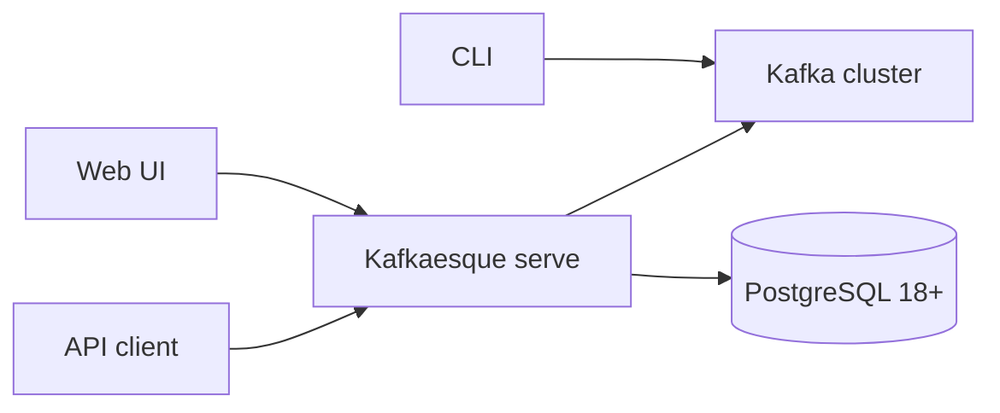

The CLI connects directly to Kafka. Server-rendered UI and JSON API handlers
share the same authenticated Kafka transport and live collectors; the UI does
not call the API over loopback. PostgreSQL stores password hashes, sessions,
users, roles, and permissions. See [Architecture](docs/architecture.md).

## Security

- Keep Kafkaesque behind HTTPS and a private ingress unless your deployment has
  an additional access-control layer.
- Store database, SASL, and bootstrap credentials in a secret manager or
  Kubernetes Secret, never in an image or repository.
- Leave secure cookies enabled outside trusted local HTTP development.
- Treat `authentication.super_admin_recovery: reinitialize` as destructive; it
  rebuilds the complete PostgreSQL `public` schema.

Read the [runtime security guide](docs/security.md) or report a vulnerability
privately as described in [SECURITY.md](SECURITY.md).

## Documentation

The [documentation index](docs/README.md) is organized by task. Useful entry
points include [Installation](docs/installation.md),
[Configuration](docs/configuration.md), [Deployment](docs/deployment.md), and
[API endpoints](docs/api/endpoints.md).

## Contributing

Read [CONTRIBUTING.md](CONTRIBUTING.md) before submitting a change. Local setup,
fixtures, and test commands are documented in
[Development](docs/development.md).

## License

Kafkaesque is available under the [MIT License](LICENSE).
