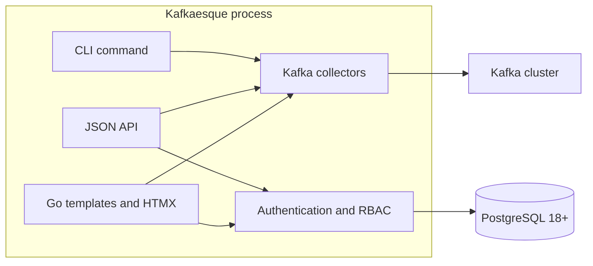
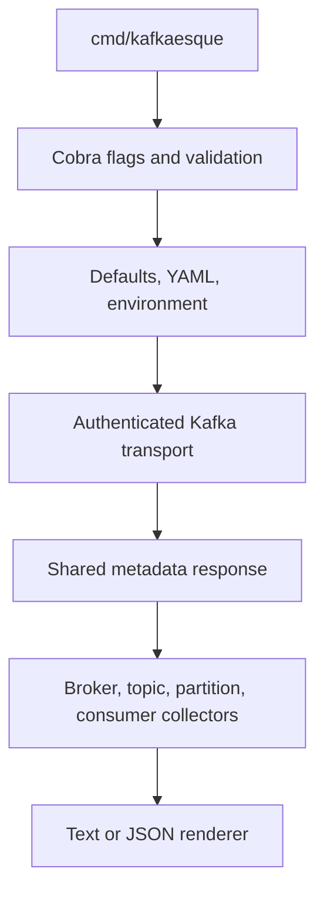
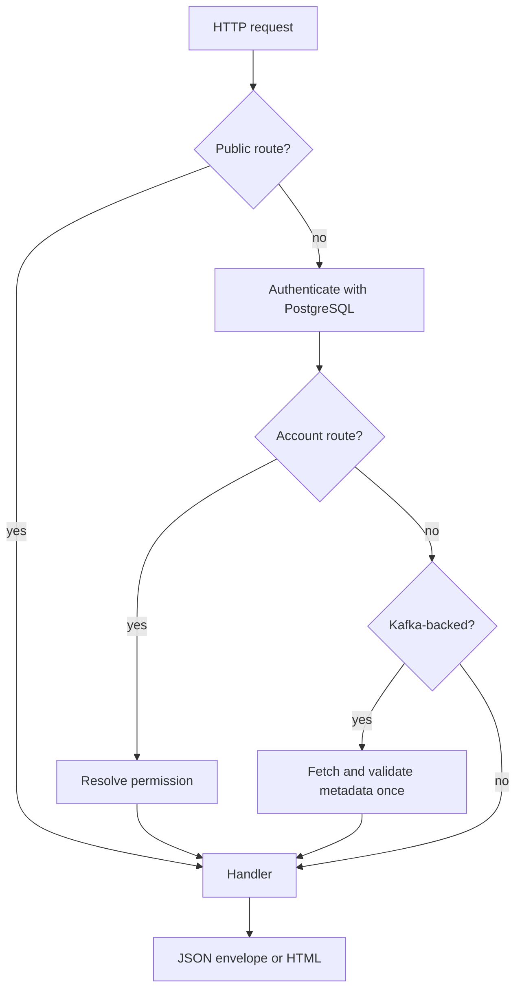

# Architecture

Kafkaesque is one Go binary with two execution modes:

- CLI inspection connects directly to Kafka and renders text or JSON.
- `serve` runs the web UI and HTTP API with PostgreSQL-backed authentication.

## Components

The UI and API call shared Go collectors in process. The UI does not call the
JSON API over loopback.

## CLI request flow

Information commands share metadata when possible. Watch mode keeps the same
Kafka connection and performs sequential refreshes.

## Server request flow

Authentication runs before Kafka connectivity middleware, so unauthenticated
requests do not contact Kafka. Request logging records route patterns, status,
duration, and authenticated user ID without query strings or secrets.

## Kafka connection

One long-lived client and transport is created for the server lifetime. It
contains bootstrap addresses, broker overrides, timeout, TLS/mTLS, and SASL.
Metadata, coordinators, partition leaders, checks, and consumer operations use
that transport; there is no unauthenticated bypass.

Consumer lag collection reads committed offsets from the group coordinator and
log-end offsets from partition leaders. Group inspection is sequential, which
keeps request behavior predictable but can be slow for clusters with many
groups.

## PostgreSQL

PostgreSQL stores application identity and session state, not Kafka history.
Embedded versioned migrations use checksums and advisory locks. Startup:

1. Validates effective server configuration.
2. Connects to PostgreSQL 18+.
3. Locks and applies migrations.
4. Verifies schema, system roles, permissions, and grants.
5. Reconciles the configured Super Admin according to recovery policy.
6. Removes expired/revoked sessions.
7. Connects to Kafka and starts HTTP serving.

Multiple replicas share PostgreSQL and use locks to avoid migration/bootstrap
races.

## UI assets

Go templates, CSS, JavaScript, HTMX, and images are embedded with `go:embed`.
No Node build, CDN, or separate frontend deployment is required. Full pages and
HTMX fragments use the same typed view models.

## Design boundaries

- Kafka is inspected but never mutated.
- Snapshots are live; there is no cache, retry layer, or stale fallback.
- Lag history, message rates, and alerts are outside the current architecture.
- API/UI authentication depends on PostgreSQL; CLI inspection does not.
- Errors are sanitized at HTTP boundaries and retain normal CLI diagnostics.
